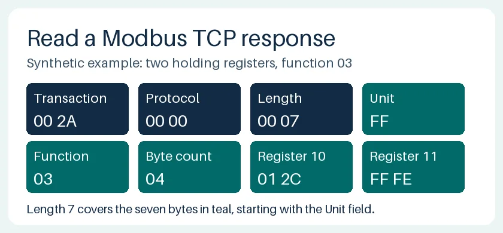

# PLC Modbus TCP: read holding registers in Python

Replay a synthetic Modbus TCP response. Learn where the address goes, how the
length field splits a TCP byte stream, and why a plausible value can belong to a
different request. The [full WIFA Robotics lesson](https://wifarobotics.com/learn/plc-modbus-tcp/)
walks through each byte and includes troubleshooting and exercises.



## Start from zero

1. Install [Python 3.10 or newer](https://www.python.org/downloads/).
2. Choose **Code → Download ZIP**, extract it, and open a terminal in the
   folder containing `modbus_lab.py`.
3. Run the commands below. On Windows use `py -3` in place of `python3`.
   The replay and tests use the standard library only.

```sh
python3 modbus_lab.py examples/split.json
python3 modbus_lab.py examples/exception.json
python3 modbus_lab.py examples/stale.json
python3 -m unittest discover -s tests -v
```

The split response yields `[300, 65534]`. The exception and stale examples
intentionally exit with status 2: the first reports exception `0x02`, the
second reports a mismatched transaction. They print no register values.
If the script or fixture cannot be found, check that the terminal is in the
extracted folder. If a capture reports a length error, inspect the raw bytes
before changing the parser.

`modbus_lab.py` builds a function 03 request, frames a byte stream and verifies
the matching response. `examples/` contains three complete synthetic inputs.
`tests/` checks exact wire bytes, every pair of split positions in the short
response, multiple frames, truncation, invalid headers, mismatches and the
125-register boundary. The original figures can be regenerated with Pillow
11 or later using `python3 diagrams/render.py`. Pillow is optional for the lab.

## Boundaries

The lab opens no sockets and sends nothing. It uses only unsigned 16-bit
holding-register words and a single outstanding request in replay. It does
not infer vendor address conventions, scaling, signed values or multiword
layout. It is an exercise in protocol parsing, not a production PLC driver or
a hardware test. Use the actual device map and an approved isolated test setup
for a physical deployment.

Sources: [Modbus Application Protocol, §6.3](https://modbus.org/docs/Modbus_Application_Protocol_V1_1b3.pdf)
and [Modbus TCP implementation guide, §3.1.3](https://modbus.org/docs/Modbus_Messaging_Implementation_Guide_V1_0b.pdf).
